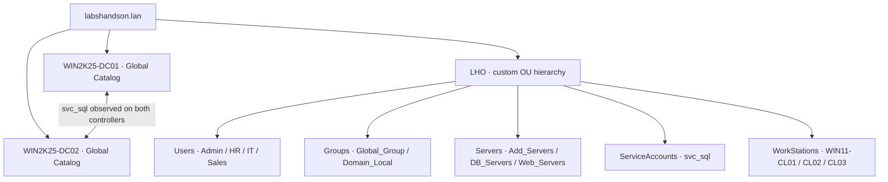

# Active Directory Administration Lab

**Author:** Pratyush Maharjan · **Platform:** VMware Workstation · **Domain:** `labshandson.lan`

I built this lab to practise the identity and workstation administration tasks used in IT support. It has grown from one domain controller and one client into a domain with two controllers, three client computer accounts, a custom OU hierarchy, departmental users/groups, and site/subnet objects.

## At a glance

| Area | Work demonstrated | Evidence |
| --- | --- | --- |
| Domain membership | Three Windows 11 computer accounts: `WIN11-CL01`, `WIN11-CL02`, `WIN11-CL03` | [Client accounts](evidence/screenshots/01-domain-client-computers.png) |
| Directory organisation | Custom `LHO` hierarchy; separate users, groups, servers, service accounts and workstations | [OU layout](evidence/screenshots/02-ou-structure-and-workstations.png) |
| Account and group administration | Departmental user properties, security groups and membership selection; account administration/client sign-in exercise | [Recorded demonstrations](docs/03-accounts-and-groups.md) |
| Domain controllers | `WIN2K25-DC01` and `WIN2K25-DC02`; both listed as global catalogs | [Two controllers](evidence/screenshots/03-two-domain-controllers.png) |
| Replication observation | `svc_sql` visible under `ServiceAccounts` through each controller | [DC01/DC02 comparison](docs/04-domain-controllers-and-replication.md) |
| Sites and subnets | Three location sites and three associated `/24` subnets; both controllers currently in the head-office site | [Site configuration](evidence/screenshots/06-sites-and-subnets.png) |

## Read the project

1. [Environment and architecture](docs/01-environment.md)
2. [OU design and workstation organisation](docs/02-ou-design.md)
3. [Accounts, groups and recorded demonstrations](docs/03-accounts-and-groups.md)
4. [Domain controllers and replication](docs/04-domain-controllers-and-replication.md)
5. [Sites and subnets](docs/05-sites-and-subnets.md)
6. [DNS troubleshooting and validation checklist](docs/06-validation-and-troubleshooting.md)
7. [Evidence gallery](evidence/README.md)
8. [Learning sources and next steps](docs/07-learning-and-next-steps.md)

## Architecture

The diagram summarises directory organisation; it does not represent physical network connections. Domain controllers remain in the domain's built-in Domain Controllers OU.

## Skills demonstrated

- Organising directory objects by administrative purpose and department.
- Managing computer accounts, user properties and group membership in Active Directory Users and Computers.
- Comparing directory objects through two domain controllers.
- Mapping IP subnets to sites in Active Directory Sites and Services.
- Separating DNS discovery, network reachability, domain membership and sign-in when troubleshooting.
- Recording results and identifying the additional tests needed before making broader reliability claims.

## Project status

**In progress, with configuration and demonstration evidence.** Screenshots and recordings document lab work at different stages. They are not a full health audit. Replication diagnostics, a complete account-disable/sign-in test, final network settings and branch-office connectivity remain on the [validation checklist](docs/06-validation-and-troubleshooting.md).
