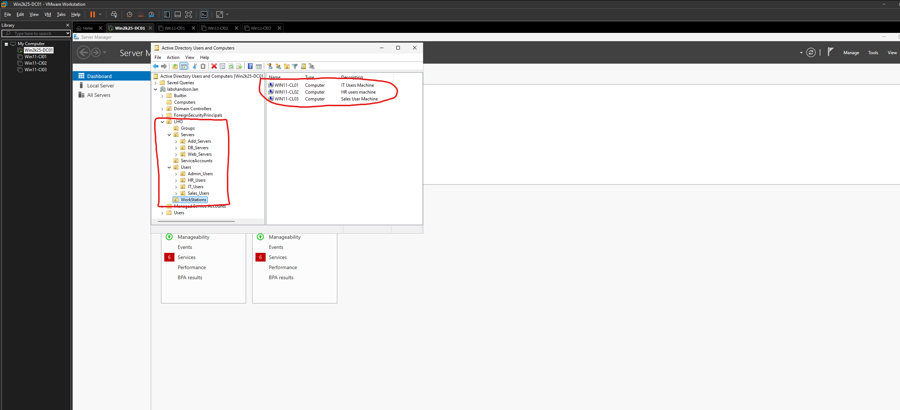

# OU design and workstation organisation

[Back to overview](../README.md)

## Observed structure

```text
labshandson.lan
├── Domain Controllers                (built-in OU)
└── LHO
    ├── Groups
    │   ├── Domain_Local              (visible in later evidence)
    │   └── Global_Group              (visible in later evidence)
    ├── Servers
    │   ├── Add_Servers
    │   ├── DB_Servers
    │   └── Web_Servers
    ├── ServiceAccounts
    ├── Users
    │   ├── Admin_Users
    │   ├── HR_Users
    │   ├── IT_Users
    │   └── Sales_Users
    └── WorkStations
        ├── WIN11-CL01
        ├── WIN11-CL02
        └── WIN11-CL03
```



## Administrative reasoning

I separated object types so that workstation, server, user and service-account administration has a clear home. Departmental user OUs make objects easier to locate. This provides a structure for future delegation and Group Policy targeting; the current evidence does not show those controls being configured.

The three workstation descriptions identify the intended departmental use: IT, HR and Sales. These descriptions help an administrator understand an object's purpose without opening each VM.

OUs organise objects and can support policy/delegation. Security groups represent membership used for permissions. Placing a user in a departmental OU alone does not grant access to departmental files.

The earlier screenshot shows the client objects in the default `Computers` container; the later screenshot shows them under `LHO/WorkStations`. The default Computers container is not an OU and cannot have a GPO linked directly to it. Moving objects into a custom OU creates a clearer basis for future workstation policy management.

The `Servers` child OUs are organisational preparation. Their presence does not demonstrate that database or web-server workloads have been deployed. The domain controllers remain in the built-in Domain Controllers OU.
