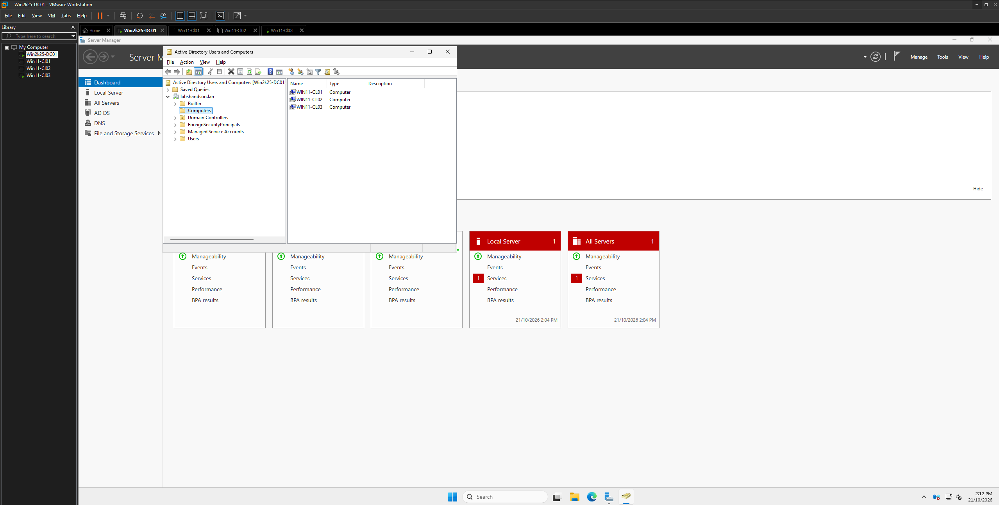
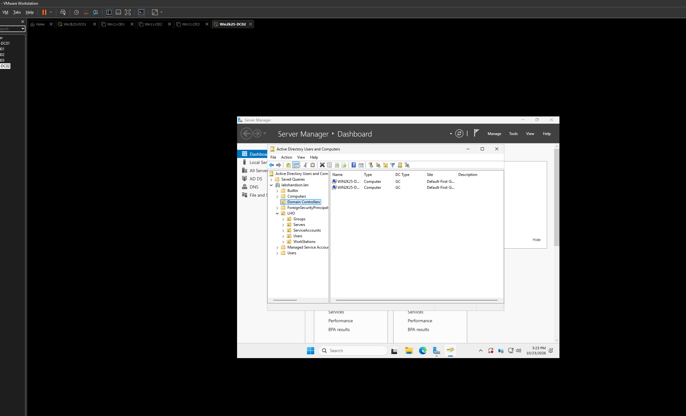
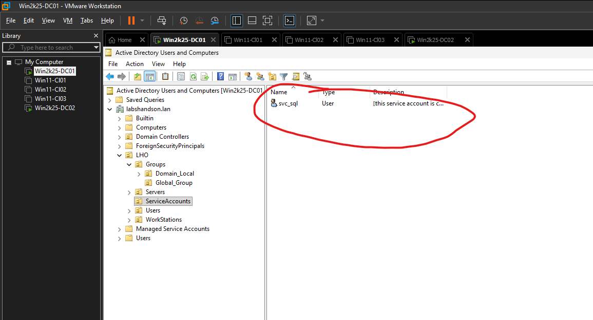
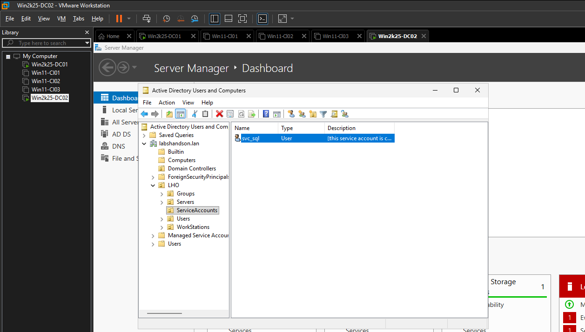
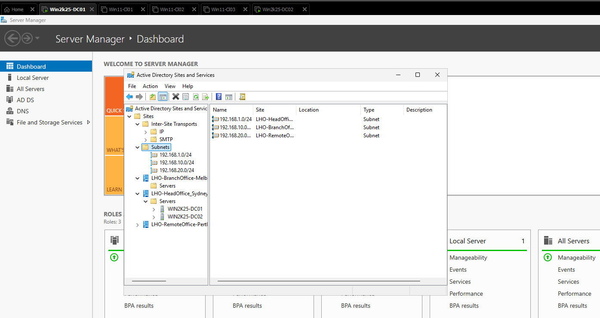

# Evidence gallery

[Back to project overview](../README.md)

Original lab screenshots are preserved with consistent filenames. The two repeated clipboard attachments match the DC01 service-account image and are omitted to keep the gallery concise. Captures show different stages of the project.

## 1. Client computer accounts

`WIN11-CL01`, `WIN11-CL02` and `WIN11-CL03` appear as **Computer** objects in ADUC. The source filename says “users”; these are computer accounts.

## 2. OU structure and workstation placement

Custom organisation under `LHO`, with the three clients under `WorkStations` and descriptions for IT, HR and Sales.

## 3. Two domain controllers

Two controller entries show `GC`. This capture predates the later site organisation.

## 4–5. Service account on both controllers

`svc_sql` is visible under ServiceAccounts through both controllers. See the [replication notes](../docs/04-domain-controllers-and-replication.md) for the limits of this comparison and the next checks.

## 6. Sites and subnets

The three `/24` subnet objects are associated with location sites; both controllers are shown at head office.

## Recorded demonstrations

- [Group membership administration — about 59 seconds](videos/group-membership-administration.mp4)
- [Account administration and client sign-in — about 2 minutes 7 seconds](videos/account-administration-and-client-sign-in.mp4)

GitHub may require opening or downloading the MP4 files. The [account and group notes](../docs/03-accounts-and-groups.md) describe the observed workflow and additional verification needed.
